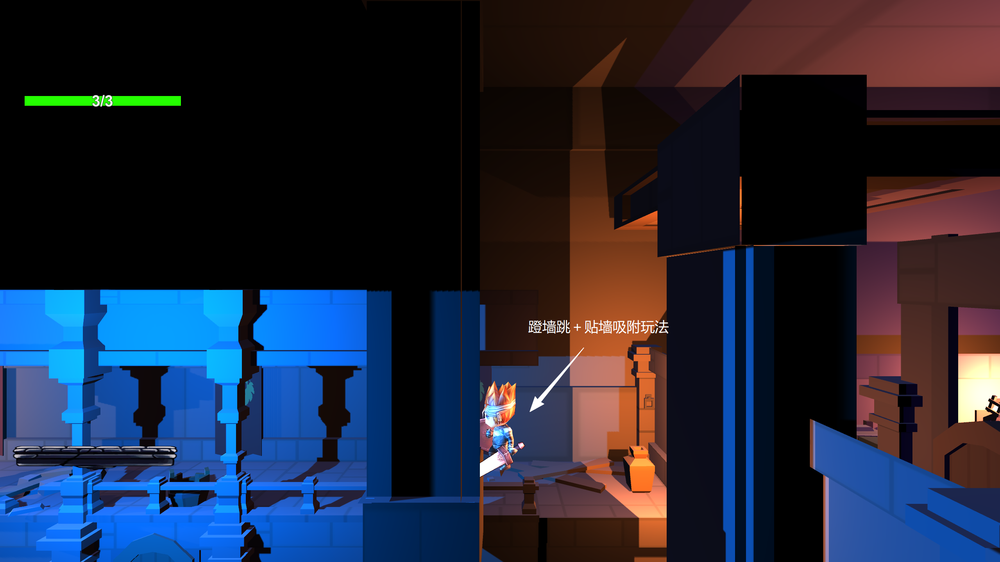
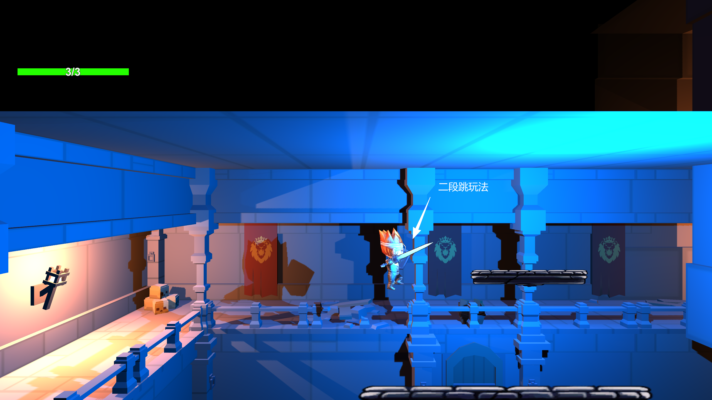
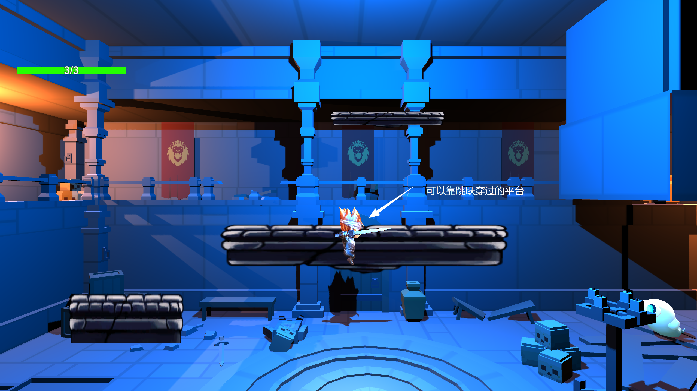
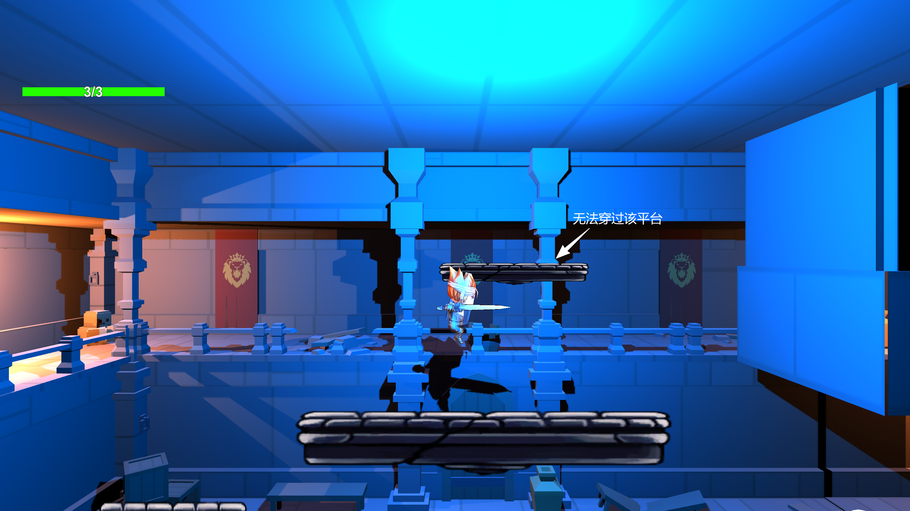
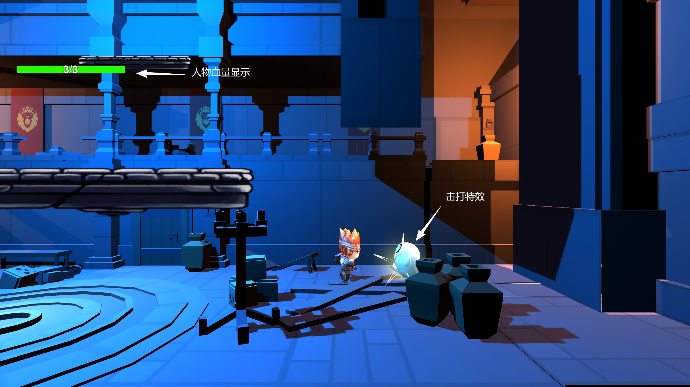
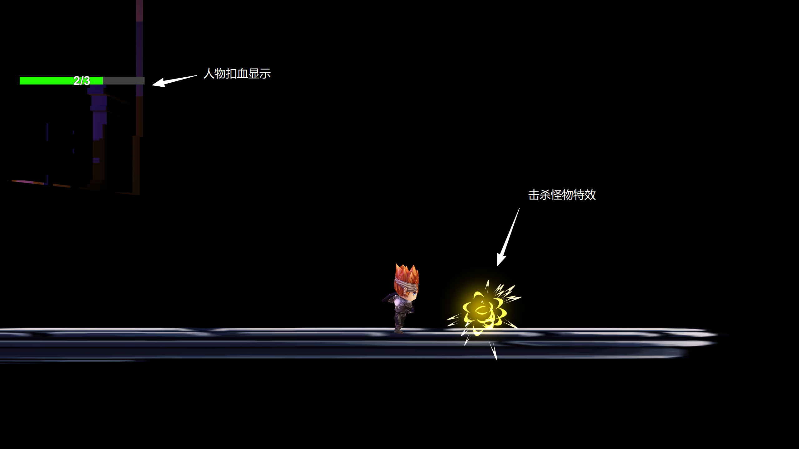

# Hollow Knight 2.5D：横版动作与平台探索 Demo

一个基于 Unity 制作的 2.5D 横版动作游戏原型。项目以“探索、移动、战斗、闯关”为体验主线，将角色控制、平台跳跃、敌人交互和即时反馈组合成一段可完整体验的 Demo 流程。

> 本仓库用于展示项目设计与运行效果，不包含完整 Unity 源工程。可执行版本和演示视频请从 GitHub Release 获取。

## 项目定位

- **项目类型**：2.5D 横版动作游戏 / 平台跳跃 Demo
- **开发引擎**：Unity
- **核心体验**：移动探索、平台跳跃、敌人战斗、生命值管理、关卡推进
- **视角特点**：以横向推进为主，结合纵向高差、悬空平台和障碍布局，形成连续的探索路线
- **设计重点**：通过清晰的角色操作、可读的场景结构和即时的战斗反馈，建立“移动—判断—操作—反馈”的循环

## 核心玩法

### 1. 角色移动与平台跳跃

角色可以在横向场景中移动，并通过普通跳跃、二段跳和平台落点判断完成路线推进。不同高度和间距的平台要求玩家控制起跳时机与落点，形成基础的空间判断与节奏变化。

### 2. 蹬墙跳与贴墙吸附

在竖向通道中加入墙面交互，玩家可以借助贴墙吸附和蹬墙跳突破单次跳跃无法到达的高度。该机制让墙体从场景边界转化为可利用的移动节点，也为关卡设计提供了纵向路线和连续操作空间。

### 3. 平台路线与障碍判断

关卡通过高低错落的平台、可穿越与不可穿越的平台组合来组织路线。玩家需要先观察落点，再选择跳跃方向；平台间距和高度差承担了引导探索、控制节奏和制造风险的作用。

### 4. 近战攻击与敌人交互

角色可以对场景中的敌人进行近战攻击。攻击动作、敌人受击表现和击打特效共同构成战斗反馈，使玩家能够明确感知“是否命中、敌人是否受伤、当前战斗是否结束”。

### 5. 生命值与击杀反馈

界面显示角色当前生命值，角色受到攻击后会产生扣血反馈；敌人被击败时通过特效强化结果确认。生命值系统让平台失误和战斗决策具有明确代价，也为关卡中的风险控制提供基础。

## 关卡与体验设计

项目围绕“先熟悉操作，再组合挑战”的思路组织 Demo 内容：

1. 通过基础平台让玩家理解移动、跳跃和落点控制。
2. 使用二段跳扩展角色的空中机动能力，增加可到达空间。
3. 通过墙面、纵向通道和蹬墙跳引入新的移动解法。
4. 在探索路线中加入敌人，使玩家在移动与战斗之间进行节奏切换。
5. 用生命值、受击特效和击杀特效提供即时反馈，帮助玩家理解操作结果。

这种设计让平台挑战与战斗挑战相互穿插，避免单一移动或单一战斗带来的重复感，同时保持横版动作游戏易于理解的操作门槛。

## 个人工作

- 参与 2.5D 横版动作游戏的玩法构思与 Demo 流程设计。
- 完成角色移动、跳跃、二段跳和蹬墙跳等基础控制体验。
- 搭建平台、墙面和纵向通道等关卡结构，调整跳跃路线与空间节奏。
- 实现角色攻击、敌人受击、生命值扣除和击杀反馈等战斗交互。
- 配置击打特效、击杀特效和界面生命值显示，强化操作反馈。
- 进行场景搭建、功能联调、运行测试和问题排查。
- 整理项目截图、制作演示视频并打包可执行 Demo。

## 技术与设计要点

- **角色控制**：围绕移动、跳跃、空中控制和墙面交互组织状态变化。
- **平台设计**：利用高度差、间距和遮挡关系构建探索路线，并控制跳跃难度。
- **战斗反馈**：将攻击动作、敌人受击、生命值变化和击杀特效串成完整反馈链路。
- **场景表达**：使用冷暖色区域和建筑式空间结构区分路线、平台与战斗区域。
- **迭代方式**：以可运行 Demo 为基础反复测试移动手感、路线可达性和反馈清晰度。

## 项目展示

下方图片均来自项目实际运行效果或功能演示素材：

| 展示内容 | 图片 |
| --- | --- |
| 蹬墙跳、贴墙吸附 | [查看原图](./蹬墙跳玩法演示.png) |
| 二段跳 | [查看原图](./二段跳玩法演示.png) |
| 敌人击打特效 | [查看原图](./怪物击打特效展示.png) |
| 生命值扣除与击杀特效 | [查看原图](./人物血量扣除、击杀特效演示.png) |
| 平台路线设计 | [查看原图 1](./跳跃平台1.png) / [查看原图 2](./跳跃平台2.png) |

## Demo 与下载

- [下载 Windows 可执行 Demo（2.5D.demo.zip）](../../releases/download/v1.0-demo/2.5D.demo.zip)
- [观看或下载项目演示视频（Demo.mp4）](../../releases/download/v1.0-demo-video/Demo.mp4)
- [查看全部 Release](../../releases)

### Windows 运行方式

1. 下载 Release 中的 `2.5D.demo.zip`。
2. 将压缩包完整解压到本地文件夹。
3. 双击其中的 `.exe` 文件启动 Demo。
4. 请保持 `.exe` 文件与对应的 `_Data` 文件夹位于同一目录，不要单独移动或删除 `_Data` 文件夹。

## 项目说明

本项目是以玩法验证和交互体验展示为目标的个人 Demo，重点呈现横版动作游戏中的角色控制、平台路线、战斗反馈和场景节奏。仓库中保留了功能截图与演示材料，方便快速了解项目效果；完整工程文件和第三方资源未公开。
